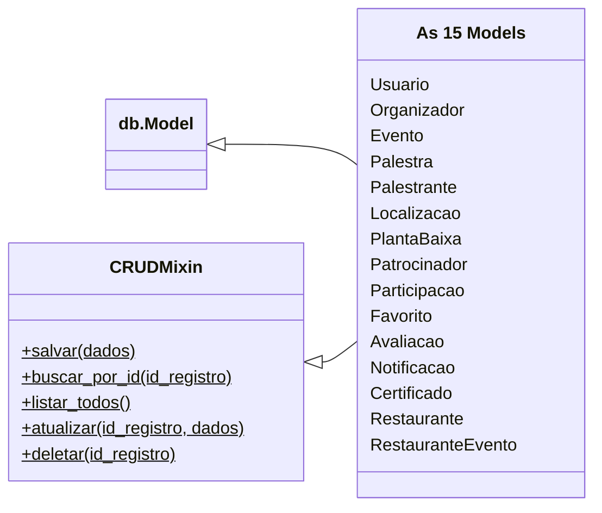
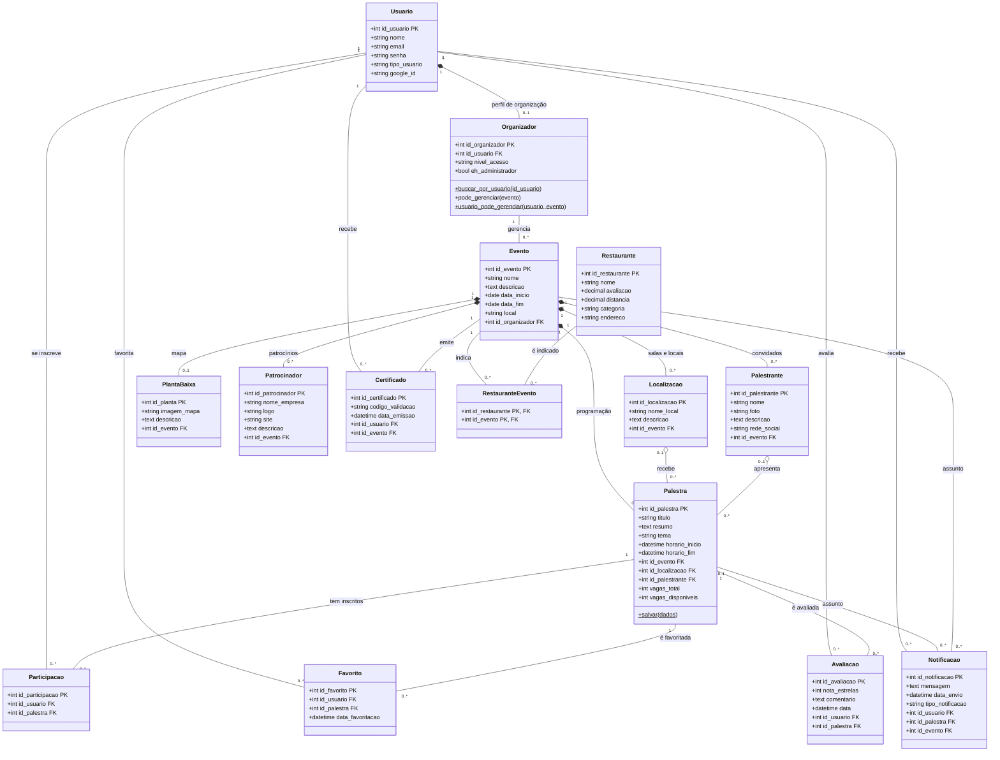

# Diagrama de classes do domínio

Representa as 15 classes de `sistema-eventos/backend/models/`: seus
atributos, seus relacionamentos e os métodos próprios. Os diagramas
foram escritos em [Mermaid](https://mermaid.js.org/), um formato de
texto que o GitHub desenha ao abrir este arquivo.

## Herança

Todas as Models herdam de duas classes. `db.Model`, do SQLAlchemy, liga
a classe a uma tabela do banco. `CRUDMixin`, do próprio projeto, oferece
os métodos de CRUD, sem repeti-los em cada Model.

A caixa "As 15 Models" resume a herança para não repetir duas setas em
cada classe. Ele não existe no código: cada Model declara a herança, como
em `class Evento(db.Model, CRUDMixin)`.

## Classes e relacionamentos

`PK` é a chave primária, que identifica cada registro. `FK` é a chave
estrangeira, que aponta para o registro de outra classe. Todas as classes
têm também o método `to_dict()`, que devolve os dados para a resposta da
API. Ele foi omitido para o diagrama ficar mais legível.

## Como ler os relacionamentos

| Símbolo | Tipo | Critério usado neste projeto |
|---|---|---|
| Losango cheio | **Composição** | A classe depende só do todo: apagar o todo apaga a parte (`ON DELETE CASCADE`) |
| Losango vazio | **Agregação** | A parte continua existindo sem o todo: o vínculo é opcional (`ON DELETE SET NULL`) |
| Linha simples | **Associação** | As duas classes se relacionam, sem que uma seja parte da outra |
| Seta com triângulo vazio | **Herança** | A classe recebe os atributos e métodos da classe mãe |

Os números ao lado das linhas são as **multiplicidades**, ou seja,
quantos objetos de cada lado podem estar ligados. Por exemplo, um
`Evento` tem de `0` a `*` (muitas) palestras, e cada `Palestra` pertence
a exatamente `1` evento.

## Decisões do modelo

- **`Evento` compõe `Palestra`.** Na Model, a relação usa
  `cascade="all, delete-orphan"`. No banco, `palestra.id_evento` usa
  `ON DELETE CASCADE`.
- **`Localizacao` e `Palestrante` agregam `Palestra` com vínculos
  opcionais.** Se a sala ou o palestrante for removido, a palestra
  continua existindo sem esse dado (`ON DELETE SET NULL`).
- **`Participacao`, `Favorito` e `Avaliacao` ligam `Usuario` e
  `Palestra`.** Representam relações de muitos para muitos com dados
  próprios ou regras próprias. Dependem das duas classes ao mesmo tempo,
  então ficam como associações, e não como partes de uma só. A mesma
  pessoa não pode repetir o par com a mesma palestra (restrição `UNIQUE`
  no banco).
- **`RestauranteEvento` liga `Restaurante` e `Evento`** em uma relação
  de muitos para muitos, porque um restaurante pode ser indicado em
  vários eventos.
- **`Organizador` é um perfil de `Usuario`, e não uma subclasse dele.**
  A ligação é feita por `id_usuario`, que é único. Por isso, ela aparece
  como composição, e não como herança.
- **`Evento` e `Organizador` têm `ON DELETE RESTRICT`.** Um organizador
  com eventos não pode ser removido, porque todo evento precisa de um
  responsável.
- **`PlantaBaixa` é única por evento por uma regra do Service.**
  `SalvarPlantaService` atualiza a planta que já existe, em vez de criar
  outra. O banco não tem restrição para isso.
- **Classes ainda sem uso no app.** `Certificado`, `Restaurante` e
  `RestauranteEvento` existem nas Models e no banco, mas ainda não têm
  rota nem tela.
