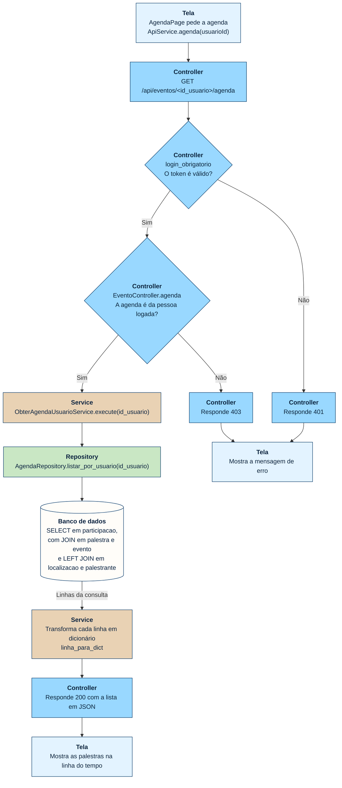

# Fluxogramas dos casos de uso

Mostram o passo a passo de dois casos de uso pelas camadas do sistema:
um de recuperação de dados (ver a agenda) e um de entrada de dados
(inscrever-se em uma palestra). Os fluxogramas foram escritos em
[Mermaid](https://mermaid.js.org/), um formato de texto que o GitHub
desenha ao abrir este arquivo.

Cada caixa começa com o nome da sua camada e tem a cor dela. Nos dois
casos, o `login_obrigatorio` confere o token antes de o método do
Controller rodar. Essa conferência usa o `TokenService`, que busca o
usuário no banco pela Model `Usuario`. Como ela é igual em todas as rotas
protegidas, aparece resumida em uma caixa só. Um erro inesperado, em
qualquer rota, responde 500; essa saída também não está nos desenhos.

| Camada | Cor | Responsabilidade |
|---|---|---|
| Tela | Azul-claro | Mostra as informações e chama a API, no app Flutter |
| Controller | Azul | Recebe a requisição HTTP, confere o acesso e devolve a resposta |
| Service | Areia | Coordena o caso de uso e aplica as regras de negócio |
| Repository | Verde | Faz as consultas com SQL explícito |
| Model | Lilás | Representa as entidades do domínio e oferece o CRUD |
| Banco de dados | Branco | Guarda os dados, no MySQL |

## Recuperação de dados: ver a agenda

A agenda é a lista de palestras em que a pessoa está inscrita. Como ela
junta dados de cinco tabelas, a consulta fica no `AgendaRepository`.

A consulta da agenda não passa por uma Model: o Repository devolve as
linhas da consulta, e o Service só as transforma em dicionários. Não há
objeto para alterar, por isso uma Model não acrescentaria nada aqui.

## Entrada de dados: inscrever-se em uma palestra

A inscrição grava uma `Participacao` e tira uma vaga da `Palestra`. Como
ela mexe em duas entidades ao mesmo tempo, a regra fica no Service.

```mermaid
flowchart TD
    T1["<b>Tela</b><br/>PalestraDetailsPage inscreve a pessoa<br/>ApiService.inscrever(usuarioId, palestraId)"]:::tela
    C1["<b>Controller</b><br/>POST /api/inscricoes"]:::controller
    C2{"<b>Controller</b><br/>login_obrigatorio<br/>O token é válido?"}:::controller
    C3["<b>Controller</b><br/>ParticipacaoController.criar<br/>Pega o id_usuario do token"]:::controller
    S0["<b>Service</b><br/>CriarInscricaoService.execute"]:::service
    M1["<b>Model</b><br/>Usuario.buscar_por_id(id_usuario)"]:::model
    B1[("<b>Banco de dados</b><br/>SELECT em usuario")]:::banco
    S1{"<b>Service</b><br/>O usuário existe?"}:::service
    R1["<b>Repository</b><br/>ParticipacaoRepository.buscar_palestra_com_bloqueio(id_palestra)"]:::repository
    B2[("<b>Banco de dados</b><br/>SELECT em palestra com FOR UPDATE")]:::banco
    S2{"<b>Service</b><br/>A palestra existe?"}:::service
    S3{"<b>Service</b><br/>A palestra ainda<br/>não começou?"}:::service
    R2["<b>Repository</b><br/>ParticipacaoRepository.buscar_inscricao(id_usuario, id_palestra)"]:::repository
    B3[("<b>Banco de dados</b><br/>SELECT em participacao")]:::banco
    S4{"<b>Service</b><br/>A pessoa ainda<br/>não está inscrita?"}:::service
    S5{"<b>Service</b><br/>Há vaga?"}:::service
    S6{"<b>Service</b><br/>O choque de horário<br/>já foi confirmado?"}:::service
    R3["<b>Repository</b><br/>ParticipacaoRepository.buscar_palestra_no_mesmo_horario(id_usuario, palestra)"]:::repository
    B4[("<b>Banco de dados</b><br/>SELECT em palestra com JOIN em participacao")]:::banco
    S7{"<b>Service</b><br/>A pessoa está inscrita em outra<br/>palestra no mesmo horário?"}:::service
    S9["<b>Service</b><br/>Monta a Participacao, tira uma vaga da Palestra<br/>e grava tudo de uma vez<br/>db.session.add e db.session.commit"]:::service
    B5[("<b>Banco de dados</b><br/>INSERT em participacao<br/>e UPDATE em palestra")]:::banco
    C4["<b>Controller</b><br/>Responde 201 com a inscrição"]:::controller
    T2["<b>Tela</b><br/>Recarrega os dados da palestra"]:::tela

    C5["<b>Controller</b><br/>Responde 401"]:::controller
    C6["<b>Controller</b><br/>Responde 400 com o motivo"]:::controller
    T3["<b>Tela</b><br/>Mostra a mensagem de erro"]:::tela
    S8["<b>Service</b><br/>Libera o bloqueio da palestra<br/>db.session.rollback"]:::service
    C7["<b>Controller</b><br/>Responde 409 com a<br/>palestra que bate no horário"]:::controller
    T4{"<b>Tela</b><br/>A pessoa quer se<br/>inscrever mesmo assim?"}:::tela
    T5["<b>Tela</b><br/>Reenvia com confirmar_choque<br/>e volta ao POST /api/inscricoes"]:::tela

    T1 --> C1 --> C2
    C2 -- Sim --> C3 --> S0 --> M1 --> B1 --> S1
    S1 -- Sim --> R1 --> B2 --> S2
    S2 -- Sim --> S3
    S3 -- Sim --> R2 --> B3 --> S4
    S4 -- Sim --> S5
    S5 -- Sim --> S6
    S6 -- Não --> R3 --> B4 --> S7
    S7 -- Não --> S9
    S6 -- Sim --> S9
    S9 --> B5 --> C4 --> T2

    C2 -- Não --> C5 --> T3
    S1 -- Não --> C6
    S2 -- Não --> C6
    S3 -- Não --> C6
    S4 -- Não --> C6
    S5 -- Não --> C6
    C6 --> T3
    S7 -- Sim --> S8 --> C7 --> T4
    T4 -- Sim --> T5 --> C1
    T4 -- Não --> T2

    classDef tela fill:#E3F3FF,stroke:#003465,color:#0B2440
    classDef controller fill:#99D8FF,stroke:#003465,color:#0B2440
    classDef service fill:#E9D2B4,stroke:#003465,color:#0B2440
    classDef repository fill:#C9E7C4,stroke:#003465,color:#0B2440
    classDef model fill:#E4CFEA,stroke:#003465,color:#0B2440
    classDef banco fill:#FFFDF9,stroke:#003465,color:#0B2440
```

O `FOR UPDATE` bloqueia a linha da palestra até o fim da transação. Assim,
quando duas pessoas tentam ficar com a última vaga ao mesmo tempo, a
segunda espera a primeira terminar e já encontra a vaga ocupada. Nas
saídas com erro 400, o bloqueio acaba junto com a requisição. Só o caminho
do choque de horário libera antes, com o `rollback`.

O choque de horário não impede a inscrição: a API responde 409 e o app
pergunta o que a pessoa quer fazer. Se ela confirmar, o app envia a
inscrição de novo com `confirmar_choque`, e o fluxo recomeça do
`POST /api/inscricoes`, agora sem procurar o choque. Se ela recusar, nada
é gravado e a tela só recarrega os dados da palestra.
